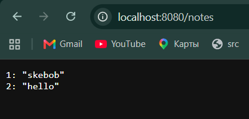

> Счётчик Redis может быть временным: явно опишите, какое состояние сохраняете, а какое допускаете потерять

Заметки сохраняются при пересоздании контейнера и обычном docker compose down, так как подключен volume 
В compose.yaml вот так 
```yaml
      volumes:
        - pgdata:/var/lib/postgresql
```

Счетчик посещений хранится в Redis и у меня реализован временным состоянием. Его можно потерять при пересоздании контейнера, поэтому Redis не подключен к volume

> В отчёте приложите команды остановки, архивирования, удаления, восстановления и ключевой вывод проверки. Создание архива без проверки восстановления не считается завершённой частью задания.

Вот тут я создала несколько notes



1. Остановила все сервисы (нет -v, чтобы не удалять volume)
```bash
docker compose down
```

2. Создала архив содержимого тома в каталоге вне исходного volume
```bash
mkdir -p backup

docker run --rm -v skebob_pgdata:/data -v "$PWD/backup:/backup" alpine:3.24 tar czf /backup/skebob_pgdata.tgz -C /data .
```

3. Удалила том
```bash
docker volume rm skebob_pgdata
```

4. Создала том заново
```bash
docker volume create skebob_pgdata
```

5. Восстановила том 
```bash
docker run --rm -v skebob_pgdata:/data -v "$PWD/backup:/backup" alpine:3.24 tar xzf /backup/skebob_pgdata.tgz -C /data
```

6. Подняла с тем же образом БД и проверила вывод
```
docker compose up -d
curl -fsS localhost:8080/notes
```
вывод был:
```
1: "skebob"
2: "hello"
```

> Объясните, почему Flask в двух сетях выполняет свои запросы к БД, но не становится автоматическим IP-маршрутизатором.
> И все что было в этом парагрфе

1. Проверяем, может ли контейнер определить IP адреса Postgres и Redis по именам, которые указаны в compose.yaml
```bash
docker compose exec app getent hosts db cache
```

2. Проверяем, может ли контейнер web определить IP адреса Postgres по имени, которое указано в compose.yaml
```bash
docker compose exec web sh -c 'getent hosts db || echo "db: имя не найдено из web"'
```

3. Проверка TCP соединения из web к Postgres
```bash
docker run --rm --network container:skebob-web-1 nicolaka/netshoot nc -zvw2 <IP адрес db> 5432
```
Ну и вывод был:
```
nc: connect to <IP адрес db> port 5432 (tcp) timed out: Operation in progress
```

Значит, что web не может подключиться к Postgres напрямую, так как они находятся в разных сетях. Что собственно и ожидалось

4. Для проверки доступа к Postgres и Redis из приложения, можно сделать просто два curl
```bash
curl -fsS localhost:8080/db
curl -fsS localhost:8080/visits
``` 

Flask подключен к двум сетям front и back, поэтому может принимать запросы от Nginx (front) и обращаться к PostgreSQL и Redis (back).
Но просто наличие двух сетей не означает, что Flask будет уметь пересылать сетевые пакеты из одной сети в другую. Для пересылки пакетов между сетями нужна отдельная настройка маршрутизации этих пакетов.
Поэтому Nginx, подключенный только к front не получает прямого доступа к PostgreSQL в другой сети back.

> Откройте образ приложения в dive до и после осмысленной оптимизации Dockerfile. Приложите оба размера, метрики и результат dive; объясните, какие слои или файлы изменились и почему поведение приложения сохранилось. Не приравнивайте PASS к минимальному размеру образа. В отчёте используйте собственный вывод и укажите версии инструментов.

Размер образа до оптимизации: 170 MB
После оптимизации: 162 MB

- Так получилось потому что использовала pip install --no-cache-dir

Image efficiency score
До оптимизации: 97.6901%
После оптимизации: 97.5831%

Potential wasted space
До оптимизации: 5.65 MB
После оптимизации: 5.66 MB

Эти показатели почти не изменились, потому что большая часть лишнего пространства связана с базовым образом, который остался прежним
Возможно из-за того что размер образа уменьшился, а объем лишнего пространства не изменился, Image efficiency score немного снизился

> Версии инструментов
```
Docker version 29.0.1, build eedd969
Docker Compose version v2.40.3-desktop.1
dive 0.13.1
```